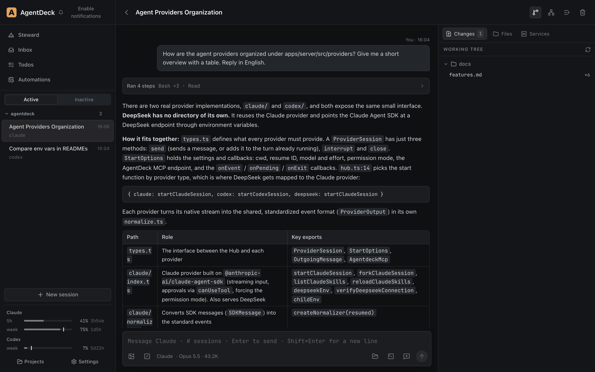
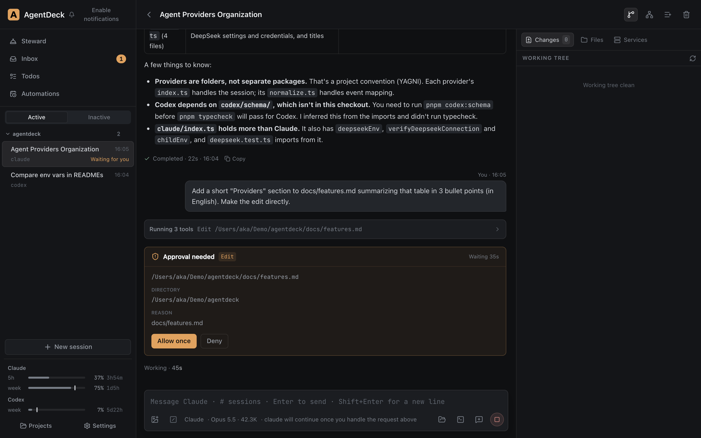
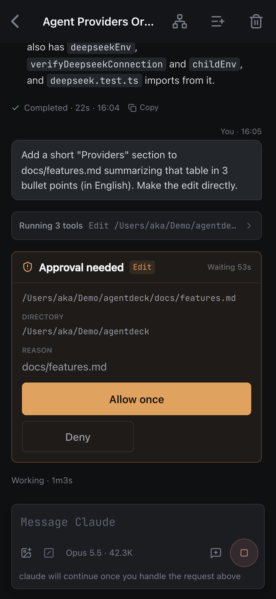

# AgentDeck

English | [简体中文](README.zh-CN.md)

A self-hosted console for Claude Code, Codex and DeepSeek. Agents run on an always-on Mac; you send messages, share screenshots, watch streaming output and handle approvals from your laptop, phone or any browser. Agents can also work on a schedule and send whatever needs your decision or attention to an Inbox.

Single user, self-hosted. Not a SaaS, no accounts.



<p>
  
  
</p>

## Features

- Parallel sessions with Claude, Codex and DeepSeek in one UI; switch providers mid-session
- Approval and question cards; sessions ask for approval by default and can be switched to bypass individually
- Inbox: agents ask, report, schedule their own wake-ups and add todos through the MCP tools `ask_user`, `report_to_user`, `wake_later` and `add_todo`; idle sessions that look unfinished get a reminder
- Scheduled tasks (Automations) and lightweight todos
- Changes panel (Git diff, per-file discard), file preview and editing, `@` file / `#` session / `$` skill completion
- PWA, can be added to a phone's home screen

## Requirements

| Item | Details |
|---|---|
| OS | **macOS**. The core server will probably run on Linux but is untested; the launchd service script and the Finder / iTerm2 integration are macOS-only, and the Services feature needs `/bin/zsh` |
| Node | ≥ 24 (uses the built-in `node:sqlite`) |
| pnpm | 11 |
| Claude | Logged in to Claude Code on this machine (log in with `claude` once; the SDK ships its own executable). `ANTHROPIC_API_KEY` is not used |
| Codex (optional) | `codex` CLI on `PATH` and logged in |
| DeepSeek (optional) | API key entered in Settings |
| Remote access (optional) | [Tailscale](https://tailscale.com/), for HTTPS access from other devices |

AgentDeck drives Claude Code and Codex with your own local login. It is meant for personal self-hosting; make sure your use complies with Anthropic's and OpenAI's terms.

## Quick start

```sh
git clone <repo> agentdeck && cd agentdeck
pnpm install
pnpm build      # builds the web app; the Hub serves it directly
pnpm start      # starts the Hub on http://127.0.0.1:8004
```

Open http://127.0.0.1:8004. On first start the repository's own directory is added as a project; add more on the Projects page (**only directories inside your home folder can be added**).

### Environment variables

| Variable | Default | |
|---|---|---|
| `AGENTDECK_PORT` | `8004` | Hub port, bound to 127.0.0.1 only |
| `AGENTDECK_DB` | `data/agentdeck.db` | SQLite database |
| `AGENTDECK_UPLOADS` | `data/uploads` | Attachments |
| `AGENTDECK_WEB_DIST` | `apps/web/dist` | Built web app; if missing, only the API is served |

All data lives under `data/` (gitignored).

### Run as a service (macOS)

```sh
scripts/launchd.sh install     # build and register with launchd: starts at login, restarts on crash
scripts/launchd.sh update      # rebuild and restart after pulling new code
scripts/launchd.sh status | logs | restart | uninstall
```

launchd does not read `~/.zshrc`. `install` copies the proxy variables (`http_proxy` and friends) from your current shell into the plist. If you need a proxy to reach Anthropic / OpenAI, set it in the shell before installing, and re-run `install` whenever it changes.

### Access from other devices

The Hub only listens on localhost. Use Tailscale Serve to expose it over HTTPS inside your tailnet (PWA features such as adding to the home screen require HTTPS):

```sh
tailscale serve --bg --https=8450 8004
```

Then open `https://<machine>.<tailnet>.ts.net:8450` from any device in the tailnet.

## Security model (please read)

AgentDeck has **no login or authentication**. Access control relies entirely on listening on 127.0.0.1 and exposing it only on a trusted private network such as Tailscale. Anyone who can open the page can:

- start agents in any project inside your home folder, including in bypass mode (commands run without approval)
- run arbitrary shell commands through the Services feature
- read and write files in your projects
- read saved secrets and the DeepSeek API key

Secrets and the DeepSeek API key are stored unencrypted in `data/agentdeck.db`; anyone who can read that file can read them.

**Do not** put it behind a public reverse proxy, bind it to `0.0.0.0`, or expose it with Tailscale Funnel.

## Development

```sh
pnpm dev:server          # Hub (tsx watch), port 8004 by default
pnpm dev:web             # Vite on 5180, proxies to AGENTDECK_PORT (default 8004)
pnpm codex:schema        # generates Codex protocol types; required before typecheck (needs codex installed)
pnpm typecheck
pnpm --filter @agentdeck/server test
```

If a Hub is already running as a service, develop on another port and give both sides the same value: `AGENTDECK_PORT=8024 pnpm dev:server` and `AGENTDECK_PORT=8024 pnpm dev:web`.

Design and implementation docs in `docs/` are in Chinese: `features.md` covers each feature's behavior and limits, `remote_agent_hub_technical_plan.md` the architecture and protocol. Conventions for AI coding assistants are in `AGENTS.md`.

### Finder / iTerm2 integration (optional)

On **the Mac you browse from**, run `scripts/install-finder-helper.sh` (requires Xcode Command Line Tools). Then in Settings, map the Hub machine's folder to where it is mounted locally and set the SSH host. Sessions can then reveal files in Finder and open an iTerm2 SSH session in the project folder.

## License

[MIT](LICENSE)
