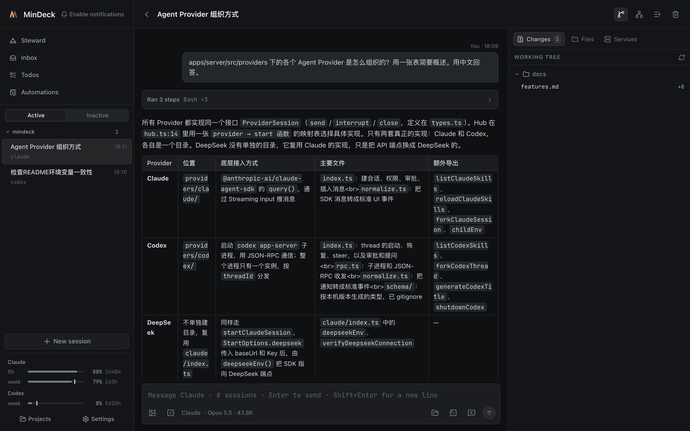
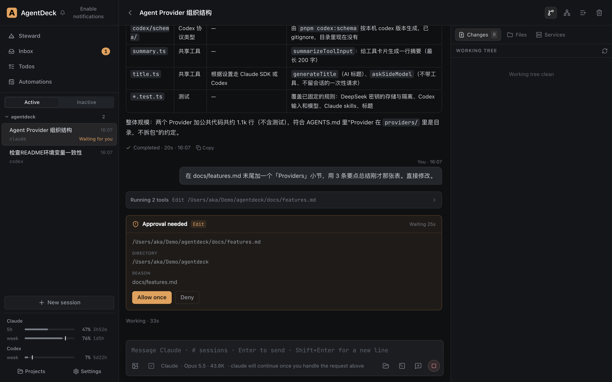
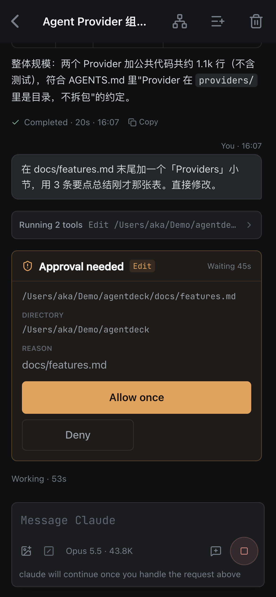

# MinDeck

[English](README.md) | 简体中文

自托管的 Claude Code / Codex / DeepSeek 控制台。Agent 跑在一台常开的 Mac 上，你在笔记本、手机或任意浏览器里发消息、传截图、看流式输出、处理审批；Agent 可以按定时任务自己干活，有需要你决定或想汇报的事情会进 Inbox。

单用户自用，不是 SaaS，也没有账号体系。



<p>
  
  
</p>

## 功能

- 多会话并行，Claude / Codex / DeepSeek 统一界面，会话中途可切换 Provider
- 审批卡、提问卡；权限模式默认逐项审批，可按会话改为 bypass
- Inbox：Agent 通过 MCP 工具 `ask_user` / `report_to_user` / `wake_later` / `add_todo` 提问、汇报、预约唤醒、记待办；空闲会话的"没收尾"提醒
- 定时任务（Automations）、轻量待办
- 改动侧栏（Git diff、单文件回退）、文件预览与编辑、`@` 文件 / `#` 会话 / `$` skill 补全
- PWA，手机可添加到主屏幕

## 运行要求

| 项 | 说明 |
|---|---|
| 系统 | **macOS**。核心服务在 Linux 上大概率能跑，但未验证；常驻脚本（launchd）、Finder / iTerm2 联动只支持 macOS，Services 功能依赖 `/bin/zsh` |
| Node | ≥ 24（使用内置 `node:sqlite`） |
| pnpm | 11 |
| Claude | 本机已登录 Claude Code（`claude` 登录一次即可，SDK 自带可执行文件）。不使用 `ANTHROPIC_API_KEY` |
| Codex（可选） | `codex` CLI 在 PATH 中并已登录 |
| DeepSeek（可选） | 在设置页填 API Key |
| 远程访问（可选） | [Tailscale](https://tailscale.com/)，用于从其他设备通过 HTTPS 访问 |

MinDeck 使用你本机自己的登录来驱动 Claude Code 和 Codex，仅面向个人自托管；请自行确认你的用法符合 Anthropic 与 OpenAI 的服务条款。

## 快速开始

```sh
git clone <repo> mindeck && cd mindeck
pnpm install
pnpm build      # 构建前端，Hub 会直接托管产物
pnpm start      # 启动 Hub，默认 http://127.0.0.1:8004
```

打开 http://127.0.0.1:8004 。首次启动会把仓库所在目录加为项目，之后可在 Projects 页添加其他目录（**只能添加家目录内的目录**）。

### 环境变量

| 变量 | 默认 | 说明 |
|---|---|---|
| `MINDECK_PORT` | `8004` | Hub 端口，只监听 127.0.0.1 |
| `MINDECK_DB` | `data/mindeck.db` | SQLite 数据库 |
| `MINDECK_UPLOADS` | `data/uploads` | 附件目录 |
| `MINDECK_WEB_DIST` | `apps/web/dist` | 前端构建产物；不存在时只提供 API |

数据都在 `data/` 下（已 gitignore）。

### 常驻运行（macOS）

```sh
scripts/launchd.sh install     # 构建并注册 launchd，开机自启、崩溃自动拉起
scripts/launchd.sh update      # 拉新代码后重新构建并重启
scripts/launchd.sh status | logs | restart | uninstall
```

launchd 不读 `~/.zshrc`。`install` 会把当前 shell 的代理变量（`http_proxy` 等）写进 plist；需要代理才能访问 Anthropic / OpenAI 时，先在 shell 里设好再 install，改了代理要重新 install。

### 从其他设备访问

Hub 只监听本机。推荐用 Tailscale Serve 在 tailnet 内提供 HTTPS（手机添加到主屏幕等 PWA 功能需要 HTTPS）：

```sh
tailscale serve --bg --https=8450 8004
```

然后在 tailnet 内的设备打开 `https://<机器名>.<tailnet>.ts.net:8450`。

## 安全模型（请务必读）

MinDeck **没有登录和鉴权**，访问控制完全依赖"只监听 127.0.0.1 + 只在可信私有网络（如 Tailscale）中暴露"。能打开页面的人就能：

- 在你的家目录内任意项目启动 Agent，包括 bypass 模式（无审批执行命令）
- 通过 Services 功能执行任意 shell 命令
- 读写项目内文件
- 读取已保存的密钥和 DeepSeek API Key

密钥和 DeepSeek API Key 以明文存放在 `data/mindeck.db`，能读到这个文件的人就能拿到它们。

**不要**把它反向代理到公网，不要改成监听 `0.0.0.0`，也不要用 Tailscale Funnel。

## 开发

```sh
pnpm dev:server          # Hub（tsx watch），默认 8004
pnpm dev:web             # Vite 5180，代理到 MINDECK_PORT（默认 8004）
pnpm codex:schema        # 生成 Codex 协议类型，typecheck 前需要（依赖本机 codex）
pnpm typecheck
pnpm --filter @mindeck/server test
```

本机已有常驻 Hub 时，开发用别的端口，并让前后端一致：`MINDECK_PORT=8024 pnpm dev:server` 与 `MINDECK_PORT=8024 pnpm dev:web`。

设计与实现文档（中文）在 `docs/`：`features.md` 是各功能的行为与边界，`remote_agent_hub_technical_plan.md` 是架构与协议。AI 编码助手的约定见 `AGENTS.md`。

### Finder / iTerm2 联动（可选）

在你**使用浏览器的那台 Mac** 上运行 `scripts/install-finder-helper.sh`（需要 Xcode Command Line Tools），然后在设置页配置 Hub 主机目录到本机挂载目录的映射、SSH 主机名。之后可以在会话里一键用 Finder 打开文件、用 iTerm2 SSH 到项目目录。

## License

[MIT](LICENSE)
